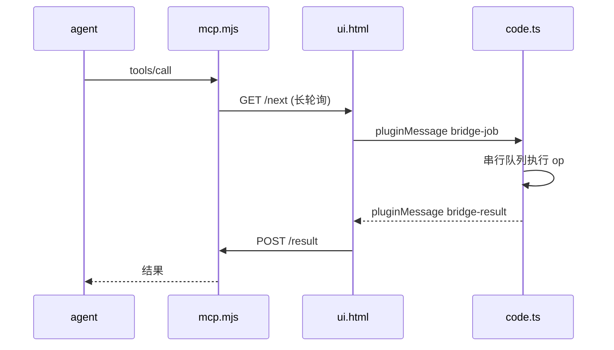

# Node Inspector · Agent 桥接

让 agent 直接读写 Figma 图层。桥接不是一个独立插件，而是 Node Inspector 内的一条可选通道。

```
agent / Cursor ──MCP(stdio)──▶ src/mcp/mcp.mjs ──HTTP──▶ Node Inspector ──▶ 文档
                                          hub:3999                  面板「Agent」开关
```

## 为什么合并

Figma **同一时刻只能运行一个插件**，且插件关闭即停止，无法后台常驻。
若桥接做成独立插件，它会长期占住唯一的插件槽位，导致无法边用 agent 边导出。

合并后：

- 开关默认**关闭** → 零网络请求，导出性能完全不受影响
- 开关打开 → 才开始轮询 hub，接受 agent 下发的操作
- 导出进行中 → 轮询自动让路，不抢主线程

## 结构

```
src/bridge/           插件侧（跑在 Figma 沙箱里）
├── index.ts          桥接编排：串行队列 + 文档变更回调
├── ops.ts            op 注册表（改文档的实际逻辑）
├── layer-order.mjs   层级重排纯逻辑    ← 已单测
├── queue.mjs         串行队列          ← 已单测
├── poll-timer.mjs    暂停 / 退避策略   ← 已单测
├── client.ts         UI 侧网络出口（轮询 hub）
├── panel.ts          状态灯 + 开关
└── ui-entry.ts       挂载到 ui.html

src/mcp/              本机进程（agent 侧）
├── mcp.mjs           stdio 入口
├── protocol.mjs      JSON-RPC 方法表
├── tools.mjs         工具清单 = 唯一真相来源
├── core.mjs          队列 / 在途 / 超时状态机（零 IO）
└── hub.mjs           HTTP 传输层
```

职责边界：

| 层 | 可以做 | 不可以做 |
|---|---|---|
| `ui.html` | 发 HTTP、长轮询 | 改文档 |
| `code.ts` | 改文档 | 发 HTTP（沙箱没有 fetch） |
| `ops.ts` | 单个 op 的原子操作 | 跨 op 编排、网络 |
| `src/mcp/` | 排队、转发、超时 | 直接碰 Figma 文档 |

## 消息流



## 安装与使用

```bash
npm install
npm run build          # code.js + 两个 UI bundle
npm test               # test:bridge + test:mcp
```

Figma → Plugins → Development → **Import plugin from manifest…** → 选 `manifest.json`。

1. 起 hub：`npm run mcp`（监听 `127.0.0.1:3999`）
2. Figma 里运行 **Node Inspector**，点面板顶部 **Agent 开启**
3. 状态灯变绿（已连接）后，agent 即可调用工具

不使用时点**关闭**，插件完全不联网。

## 接入时改动的地方

- `code.ts`：`UiMessage` 增加 `bridge-hello` / `bridge-job`；`onmessage` 顶部前置分发
- `ui.html`：`#ni-bridge-root` 挂载点 + 样式 + `bridge-bundle` 占位标记
- `scripts/build-ui.mjs`：从「单 bundle」改为「认领占位标记的多 bundle」，重复构建幂等
- `manifest.json`：`networkAccess` 从 `["none"]` 改为仅本机 `127.0.0.1:3999`

## 测试分层

```bash
npm run test:bridge   # 插件侧纯逻辑 + ui.html 装配
npm run test:mcp      # MCP server：一致性 / 协议 / e2e / 真进程 stdio
npm test              # 两者都跑
```

`test:mcp` 里有一项跨模块守卫：`src/mcp/tools.mjs` 的工具 op 名必须与
`src/bridge/ops.ts` 的注册表完全一致。否则会出现「工具列得出来、调用永远失败」，
而且不报明确错误。

## 已知边界

- 开关状态不持久化，每次打开插件需手动开启
- 一次只能连一个 Figma 文件（插件运行在具体文件里）
- 导出与桥接共享主线程：导出时轮询暂停，agent 调用会排队
- `manifest.json` 现在声明了本机网络权限。发布到 Community 时审核会看到

## 排错

| 现象 | 原因 |
|------|------|
| 状态灯一直「未连接」 | hub 没起，或端口不是 3999 |
| 开关打开立即报错 | `manifest.json` 白名单里没有该端口 |
| agent 调用很慢 | 正在导出，轮询被暂停 |
| 改了 `code.ts` 没生效 | 需要 `npm run build` 后重启插件 |
| `hubReady: false` | 端口被占用，换 `NI_MCP_PORT` |